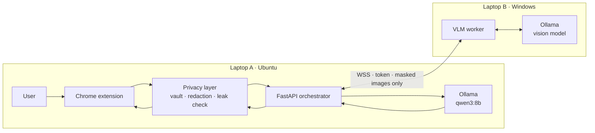

# Private Browser Automation

> A local-first browser agent that masks personal data before an AI model can see it.

[](LICENSE)
[](client/)
[](server/)

This project combines a privacy-enhanced fork of
[Nanobrowser](https://github.com/nanobrowser/nanobrowser) with a local orchestration server. You can ask the browser
agent to navigate sites, fill forms, and complete multi-step tasks while sensitive values are replaced with
placeholders such as `[[EMAIL_1]]`. The real value is restored inside the browser only when an action needs it.

The default deployment keeps the decision model on the same Ubuntu laptop as Chrome and sends only masked screenshots
to a vision model on a second Windows laptop. Both models run locally through
[Ollama](https://ollama.com/).

> [!IMPORTANT]
> This is an experimental privacy system, not a guarantee that every sensitive value will be detected. Review actions
> before allowing submissions, payments, messages, uploads, or destructive changes, and test with non-sensitive data
> first.

## Highlights

- **Redaction before transmission** — names, email addresses, phone numbers, payment details, IDs, custom values, and
  encoded variants are replaced before a model request leaves the extension.
- **Masked screenshots** — known sensitive values are painted over before an image is made available to the model.
- **Fail-closed leak check** — a request is blocked if the final scan still finds a real value or an unapproved image.
- **Local models** — a text model plans the next browser action; a separate vision model describes and verifies the
  masked screen.
- **Authenticated vision link** — the two laptops communicate over WebSockets with TLS and a shared token.
- **Action verification** — the browser layer reports what happened, the orchestrator rejects invalid or repeated
  commands, and risky clicks receive extra checks.
- **Site memory** — successful, vision-confirmed flows can be stored as value-free playbooks and replayed on matching
  pages.
- **Text-only fallback** — the orchestrator can run without the second laptop while you develop or test the basic
  pipeline.

## How it works



For every agent step:

1. The extension reads a structured outline of the active page and, when needed, takes a screenshot.
2. The privacy layer replaces sensitive text with stable placeholders and masks the same values in images.
3. A final leak check blocks unsafe requests instead of forwarding them.
4. The orchestrator asks the local text model for one constrained JSON action.
5. The optional vision worker describes the masked screen, checks ambiguous actions, and verifies completion.
6. The extension resolves placeholders locally just before typing into the page.

See [How it works](docs/how-it-works.md) for the full request lifecycle, safeguards, and current limitations.

## Requirements

The supported two-laptop setup uses:

| Laptop A | Laptop B |
| --- | --- |
| Ubuntu | Windows 10 or 11 |
| Chrome | PowerShell |
| Python 3 | Python 3.12 |
| Node.js 24 and Corepack/pnpm | Ollama |
| Ollama with `qwen3:8b` | An Ollama vision model such as `gemma4` |

Both laptops must be on the same trusted local network. A GPU is strongly recommended for each local model; model
size and speed depend on the available VRAM.

## Quick start

Clone the repository on both laptops:

```bash
git clone https://github.com/agrawal-soham/browser-automation.git
cd browser-automation
```

### 1. Prepare Laptop B (Windows vision worker)

In PowerShell, replace `192.168.1.10` with Laptop A's LAN address:

```powershell
powershell -ExecutionPolicy Bypass -File server\setup\setup_laptop_b.ps1 `
  -Model gemma4 `
  -LaptopAIp 192.168.1.10
```

The script installs missing prerequisites, creates `server\.venv`, pulls the model, generates a TLS certificate and
token, and restricts port `8765` to Laptop A. Add `-AutoStart` if the worker should start when you sign in.

Start the worker and leave the window open:

```powershell
cd server
powershell -ExecutionPolicy Bypass -File vlm_worker\start_worker.ps1 -Model gemma4
```

Copy only these two files from Laptop B to Laptop A:

| From Laptop B | To Laptop A |
| --- | --- |
| `C:\privacy-agent\tls\cert.pem` | `~/privacy-agent/tls/laptop-a/laptop-b.pem` |
| `C:\privacy-agent\tls\token` | `~/privacy-agent/tls/laptop-a/token` |

Never copy or expose `key.pem`.

### 2. Prepare Laptop A (Ubuntu browser and orchestrator)

Replace `192.168.1.20` with Laptop B's LAN address:

```bash
server/setup/setup_laptop_a.sh --laptop-b-ip 192.168.1.20
```

The script creates the Python environment, installs server dependencies, pulls `qwen3:8b`, builds the extension, and
writes `~/privacy-agent/laptop-a.env`. It is safe to run again after updating the repository.

Start and check the orchestrator:

```bash
server/run_orchestrator.sh
```

In another terminal:

```bash
curl http://localhost:8000/health
curl http://localhost:8000/health/vlm
```

A healthy response reports `qwen3:8b` as the text model and the model running on Laptop B as `vlm`. The VLM health
check also asks the remote model to read a random number from a generated test image.

### 3. Load and configure the extension

1. Open `chrome://extensions`.
2. Enable **Developer mode**.
3. Select **Load unpacked** and choose `client/dist`.
4. Open the extension's **Settings → Providers**.
5. Add an **OpenAI-compatible** provider with:

   - Base URL: `http://localhost:8000/v1`
   - API key: any non-empty value, such as `local`
   - Model: `privacy-agent`

6. Run the provider test, then select `privacy-agent` in the side panel.

You can now open a page and give the agent a task in plain language. Start with a disposable form and fake data while
validating your setup.

For manual installation, network troubleshooting, certificate renewal, and firewall details, read the
[complete setup guide](docs/setup.md).

## Text-only development setup

To run everything on one machine without the vision worker:

```bash
ollama pull qwen3:8b

cd server
python3 -m venv .venv
.venv/bin/pip install -r requirements.txt
.venv/bin/uvicorn orchestrator.main:app --host 127.0.0.1 --port 8000
```

Build the extension in a second terminal:

```bash
cd client
corepack enable
corepack pnpm install --frozen-lockfile
corepack pnpm build
```

Load `client/dist` in Chrome and configure the provider as described above. Without `VLM_URL`, visual perception and
verification are unavailable, but text-based browser automation remains usable.

## Configuration

Laptop A reads the file created at `~/privacy-agent/laptop-a.env`. You can also set environment variables before
starting `server/run_orchestrator.sh`.

| Variable | Default | Purpose |
| --- | --- | --- |
| `TEXT_MODEL` | `qwen3:8b` | Ollama model that chooses browser actions |
| `TEXT_NUM_CTX` | `8192` | Text-model context window |
| `OLLAMA_URL` | `http://localhost:11434` | Ollama API on Laptop A |
| `VLM_URL` | empty | Vision worker URL, normally `wss://<laptop-b>:8765` |
| `VLM_CA_FILE` | empty | Certificate used to verify Laptop B |
| `VLM_TOKEN_FILE` | empty | File containing the shared worker token |
| `VLM_TIMEOUT_S` | `60` | Vision request timeout |
| `PERCEIVE` | `auto` | Page perception mode: `auto`, `thin`, or `never` |
| `SITE_MEMORY` | `replay` | Playbook behavior: `replay`, `hints`, or `off` |
| `LOG_IMAGES` | disabled | Save masked screenshots under `server/logs/images/` |
| `LOG_DIR` | `server/logs` | Request-log directory |

Additional settings are documented in [`server/orchestrator/config.py`](server/orchestrator/config.py).

## Testing

Server tests:

```bash
cd server
.venv/bin/python -m pytest
```

Client checks:

```bash
cd client
corepack pnpm type-check
corepack pnpm lint
corepack pnpm test
```

The client also includes browser-level scenarios for masking, action receipts, dialogs, frames, permissions, and
end-to-end privacy checks. See [client/README.md](client/README.md) and [docs/setup.md](docs/setup.md) for the live
evaluation commands.

## Repository layout

```text
browser-automation/
├── client/       Nanobrowser fork, privacy layer, UI, and browser-control code
├── server/       FastAPI orchestrator, local-model clients, VLM worker, and tests
├── contracts/    Shared JSON schema for constrained browser commands
└── docs/         Architecture, setup, implementation notes, and project findings
```

Useful documentation:

- [System walkthrough](docs/how-it-works.md)
- [Detailed two-laptop setup](docs/setup.md)
- [Dependency graph](docs/dependency-graph.md)
- [Server reference](server/README.md)
- [Client development guide](client/README.md)
- [Project plan](docs/plan.md)

## Privacy and security notes

- The VLM worker's private key must remain on Laptop B. Share only its public certificate and token with Laptop A.
- Keep the orchestrator bound to `127.0.0.1`; the browser runs on the same laptop and does not need a LAN-exposed API.
- Keep port `8765` limited to Laptop A on a private network.
- Request logs omit image bodies, but may still contain task text and placeholders. Treat the log directory as private.
- `LOG_IMAGES=1` stores screenshots that have already passed through masking, but those images can still contain
  context you consider sensitive.
- Custom privacy rules improve coverage for values that generic detectors cannot identify reliably.
- Site-memory playbooks store task templates and element names rather than the values entered into fields.

## Acknowledgements

The browser extension is based on [Nanobrowser](https://github.com/nanobrowser/nanobrowser). The local inference
pipeline uses [Ollama](https://ollama.com/), [FastAPI](https://fastapi.tiangolo.com/), and open-source text and vision
models.

## License

Licensed under the [Apache License 2.0](LICENSE).
