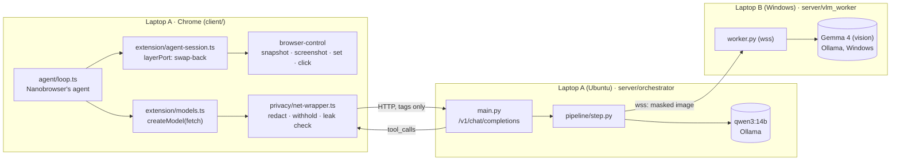
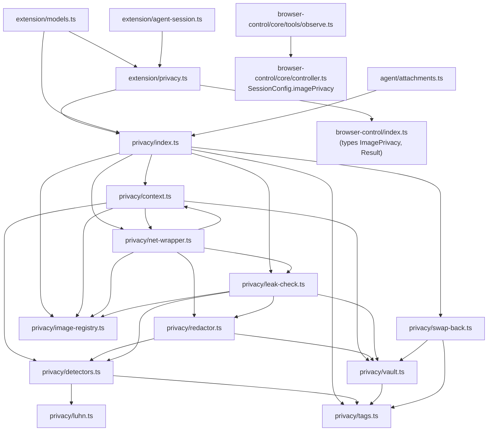

# Dependency graph

_Update this whenever a file is added or an import changes. Arrows point from a file to what it uses._

## Runtime flow (who calls whom across machines)



## Client: `client/src/privacy/` and the files that use it



The layer (`src/browser-control/`) still imports nothing from outside its folder. The privacy hook reaches it as a
`SessionConfig` value that `extension/agent-session.ts` passes in.

## Server: `server/`

```mermaid
flowchart TD
  main["orchestrator/main.py"]
  turn["orchestrator/turn.py"]
  step["orchestrator/pipeline/step.py"]
  check["orchestrator/pipeline/check.py"]
  verify["orchestrator/pipeline/verify.py"]
  prompt["orchestrator/prompt.py"]
  decide["orchestrator/prompts/decide.txt"]
  tm["orchestrator/text_model.py"]
  cmd["orchestrator/command.py"]
  fmt["orchestrator/formatter.py"]
  link["orchestrator/vlm_link.py"]
  img["orchestrator/imaging.py"]
  cfg["orchestrator/config.py"]
  log["orchestrator/request_log.py"]
  proto["vlm_worker/protocol.py"]
  worker["vlm_worker/worker.py"]
  vm["vlm_worker/vlm_model.py"]

  main --> turn & step & tm & fmt & link & log & cfg & cmd
  step --> check & verify & prompt & tm & link & cmd & cfg & turn
  check --> cmd & turn
  e2e["tests/e2e_report.py"] -. reads .-> log
  verify --> img & link & cmd & turn
  prompt --> decide & turn
  tm --> cmd & cfg
  fmt --> cmd
  link --> proto & cfg
  worker --> proto & vm
  ps1["vlm_worker/start_worker.ps1"] --> worker
  certpy["tools/make_worker_cert.py"] -. makes TLS files for .-> worker
  setupb["setup/setup_laptop_b.ps1"] --> certpy & ps1
  seta["setup/setup_laptop_a.sh"] -. writes laptop-a.env for .-> runa["run_orchestrator.sh"] --> main
  vm --> proto
  schema["contracts/command.schema.json"] -. generated from .-> cmd
```

## External packages

| Side | Package | Used by |
|---|---|---|
| client | `ai`, `@ai-sdk/openai` (already in the fork) | `extension/models.ts`; our `fetch` is passed to it |
| server | `fastapi`, `uvicorn` | `orchestrator/main.py` |
| server | `httpx` | `text_model.py`, `vlm_model.py` (Ollama HTTP API) |
| server | `websockets` | `vlm_link.py`, `worker.py` |
| server | `pydantic` | `command.py`, `protocol.py` |
| server | `pillow` | `imaging.py` |
